# Weld symbol basics (AWS A2.4 and ISO 2553)

Reference notes, paraphrased. Fetched 2026-11-19. Primers only; AWS A2.4 itself governs.

---

## A. How to read and understand weld symbols (AWS practice)

- **Publisher:** Miller Electric, article library (page dated 2026-11-08).
- **URL:** https://www.millerwelds.com/resources/article-library/how-to-read-and-understand-weld-symbols
- **Read status:** full article read. Refers to ANSI/AWS A2.4.

Structure:
- **Reference line** carries everything; the **arrow** joins it to the joint.
- **Arrow side:** symbol **below** the reference line. **Other side:** symbol **above**. Holds whatever way the arrow
  points.
- **Field weld:** flag at the arrow/reference junction. No flag = shop weld. Old drawings may use a filled dot.
- **All around:** open circle at the arrow/reference junction.
- **Tail:** anything with no other place (process, electrode, notes, reference to a detail).

Fillet welds:
- Triangle with its vertical leg always on the **left**.
- **Leg size left** of the symbol; unequal legs give both sizes and the drawing shows which is longer.
- **Length right** of the symbol. No length = weld runs between dimension lines or between abrupt changes of
  direction (e.g. plate ends).
- Intermittent: length-pitch to the right; pitch is centre to centre, not the gap.

Groove welds:
- Square groove: root opening on the symbol.
- V-groove: groove angle and root opening; partial depth to the left; effective throat in parentheses after the depth.
- Bevel / J: vertical leg on the left; arrow points at the prepared piece (a break in the arrow line marks it when it
  matters).
- Flare-V / flare-bevel (curved members such as tube corners): intended weld depth in parentheses to the left.
- Penetration is not drawn.
- Melt-through and backing symbols sit across the reference line from the weld symbol; "R" in a backing symbol =
  remove after welding.

Plug / slot: hole size left, pitch right, count in parentheses; arrow vs other side says which piece has the hole.

Figures (all 21 plus Miller's one-page **symbol chart PDF** are in `images/miller-weld-symbols/`):

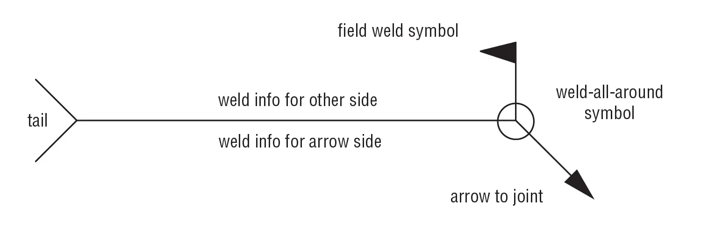

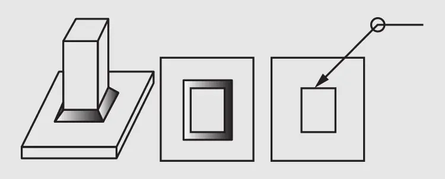

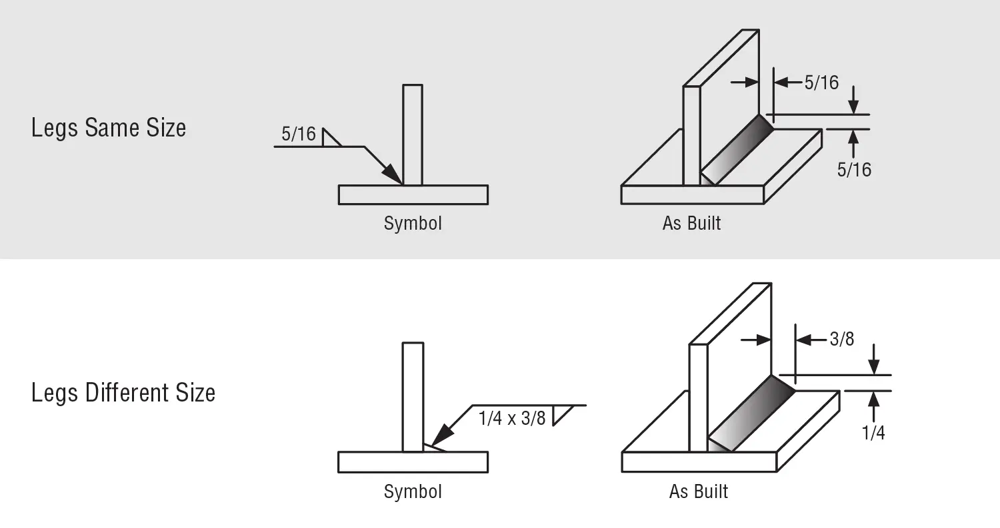

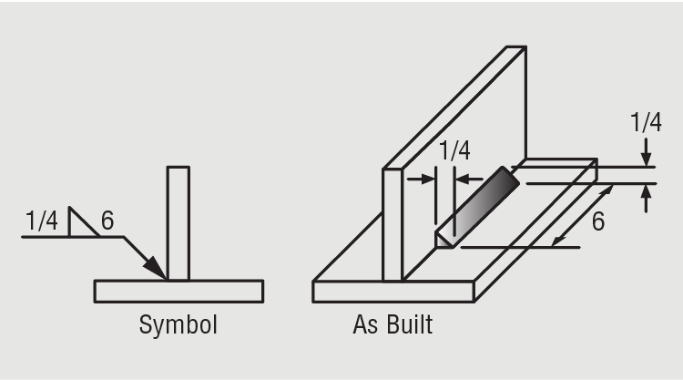

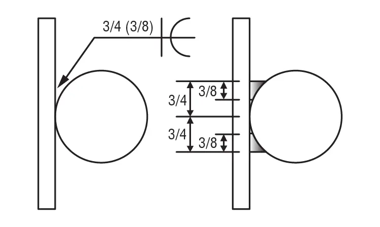

Chart: [`images/miller-weld-symbols/22-welding-symbol-chart.pdf`](images/miller-weld-symbols/22-welding-symbol-chart.pdf)

## B. A review of the application of weld symbols on drawings (British/ISO practice)

- **Publisher:** TWI Job Knowledge; author Mark Cozens; reissued 2020-04-27.
- **URL:** https://www.twi-global.com/technical-knowledge/job-knowledge/weld-symbols
- **Read status:** body summary-derived. **Covers BS EN 22553 / ISO 2553, not AWS A2.4.**

Points useful to us:
- The arrowhead touches the joint; for one-sided preparations the arrow points at the prepared part.
- ISO uses a **dashed second reference line** for the other side; AWS does not. Do not mix systems on one drawing.
- An unsized butt weld is taken as full penetration.
- Fillet contour: flush, convex or concave may be added to the triangle.
- Weld all round shown on a rectangular tube to plate example.
- Process numbers (ISO 4063) go in the tail.

Figures (all 19 in `images/twi-weld-symbols-iso/`; ISO practice, so do not copy the dashed line or a/z prefixes onto
our AWS drawings):

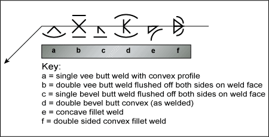

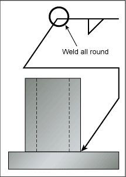

## C. Textbook figures (CC BY 4.0)

Cameren Moran, *Interpretation of Metal Fab Drawings*, Open Oregon, 2017: https://openoregon.pressbooks.pub/weldsymbols/ .
88 figures from the joints, basics, supplementary, fillet and groove chapters are in `images/open-textbook/`, each
described in `05 Image Catalogue.md`. A few of the most useful:

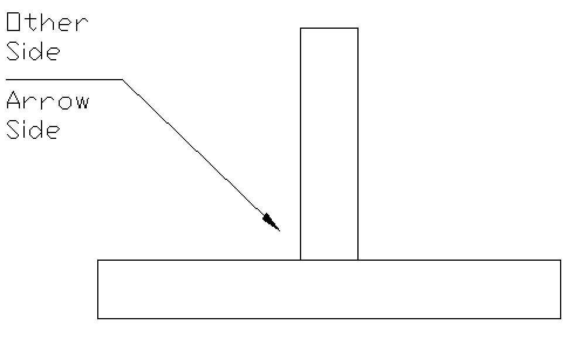

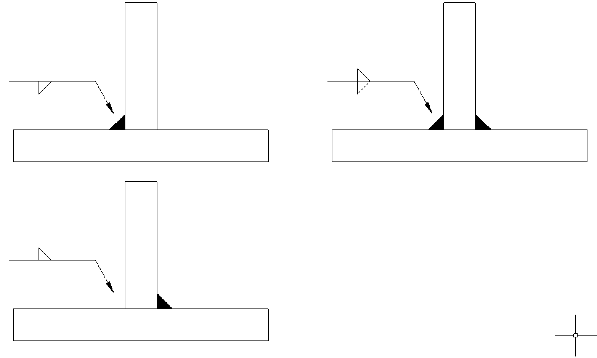

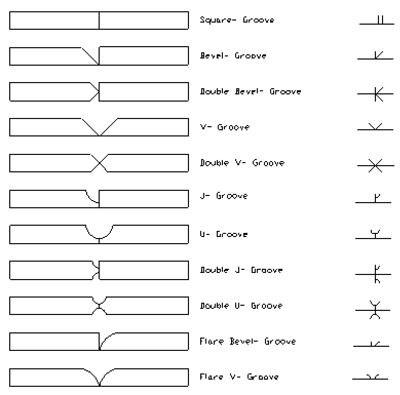

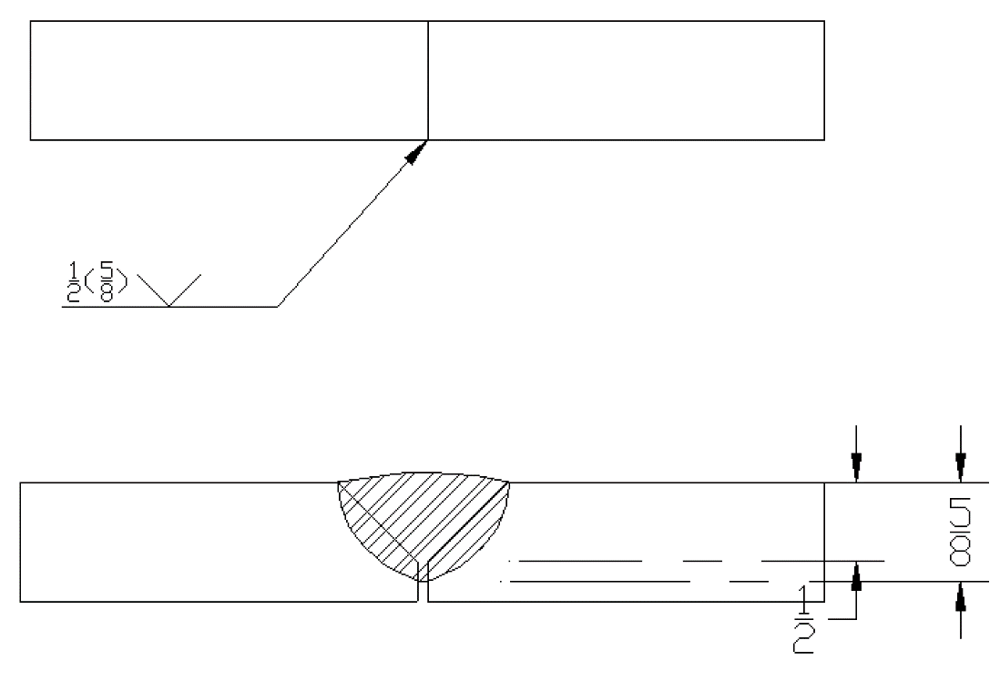

---

## Not retrieved

- Miller, "Deciphering weld symbols" (https://www.millerwelds.com/resources/article-library/deciphering-weld-symbols):
  page removed (404). Entry A above covers the same ground.
