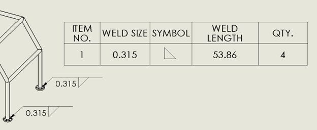
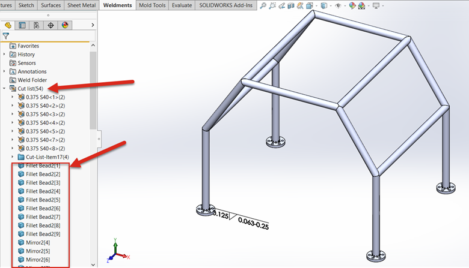
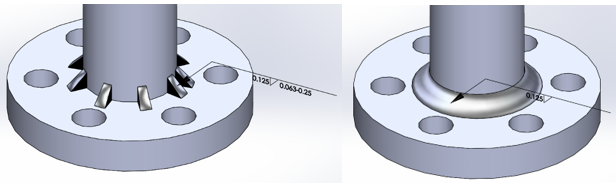
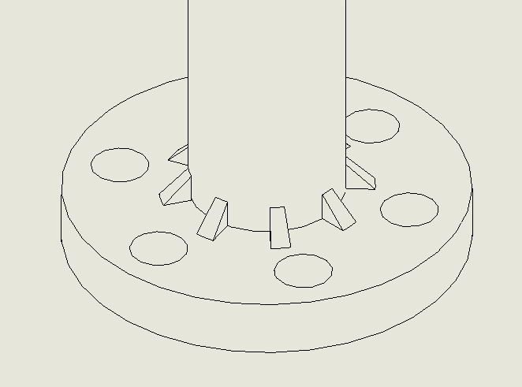
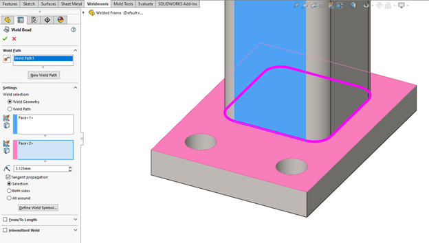
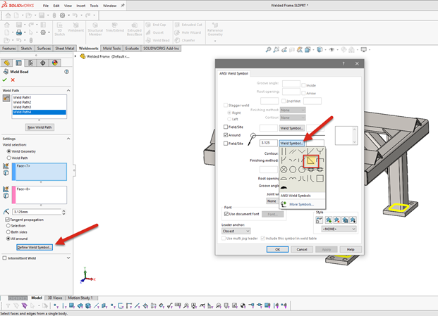
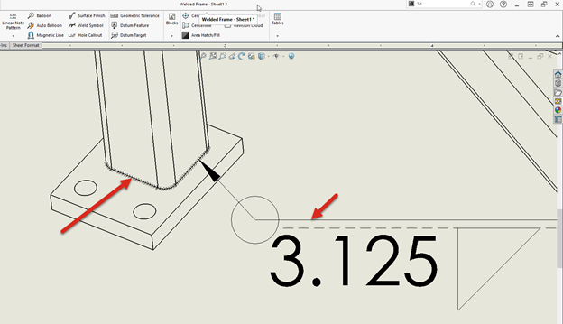
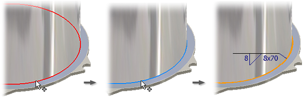
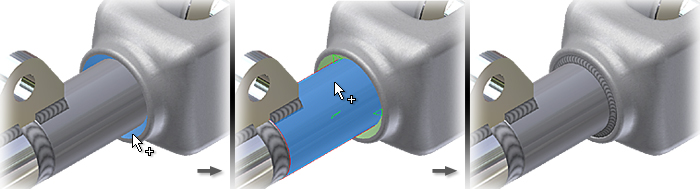

# Welds in the 3D model

Reference notes, paraphrased from CAD vendor help and reseller articles. Fetched 2026-11-19. Our models are build123d
(Python), so the "carries over" bullets are what matters; the menu steps are SolidWorks / Inventor specific.

---

## A. Weld Bead vs Fillet Bead (SOLIDWORKS)

- **Publisher:** GoEngineer blog (SOLIDWORKS reseller), Brad Hakeman, 2022-09-09.
- **URL:** https://www.goengineer.com/blog/weld-bead-vs-fillet-bead-solidworks-feature-comparison
- **Weld Bead (graphical):** no solid body, like a cosmetic thread; fast. Carries weld material, process and length as
  properties, which feed a **weld table** on the drawing.
- **Fillet Bead (solid):** a real body in the weldment; shows in the cut list; gives true **mass** and lets
  **interference** checks see the weld (e.g. bead vs a nearby mounting hole or part); appears in drawing views by
  itself. Options: full length, intermittent, staggered, size, attached symbol. Fillet only, no grooves. Does **not**
  feed a weld table.
- Advice: graphical beads for detailed weldment drawings with callouts and tables; solid beads where the physical weld
  matters for inspection or mass.

Figures (all nine in `images/goengineer-weld-vs-fillet-bead/`):

## B. Creating and adding weld beads in models and drawings (SOLIDWORKS)

- **Publisher:** GoEngineer blog, Brad Hakeman, 2022-01-18.
- **URL:** https://www.goengineer.com/blog/creating-adding-weld-beads-solidworks
- Weld path is picked as faces of the joint; tangent propagation runs it round a profile where a member meets a plate.
- "Define weld symbol" attaches the symbol to the bead; a weld folder lists each bead and its length.
- On the drawing, model items bring in the weld symbols and **"caterpillars"** (the drawn bead graphic) together.

Figures (all 13 in `images/goengineer-adding-weld-beads/`, two of them animations):

## C. Weld bead feature types (Inventor 2024)

- **Publisher:** Autodesk help.
- **URL:** https://help.autodesk.com/cloudhelp/2024/ENU/Inventor-Help/files/GUID-2B08844A-5314-476E-9B77-AD24BADFE611.htm
- **Cosmetic weld:** edges change appearance to show they are welded; a standard weld symbol holds the full
  description; no geometry; approximate mass only; covers the widest range of weld types; arrow and other side can be
  different weld types. Made by picking **edges**.
- **Solid weld (fillet or groove):** real bead, real mass, symbol on the assembly; use it when interference or mass
  matters. Made by picking **faces**; preparations optional.

## D. Welding symbols on models (Inventor 2020)

- **Publisher:** Autodesk help.
- **URL:** https://help.autodesk.com/cloudhelp/2020/ENU/Inventor-Help/files/GUID-8A972049-D2AA-410C-8AE0-0AF5B5DDD660.htm
- A model weld symbol has a reference line and a leader **attached to a model edge**; the leader follows the edge as
  the model changes.
- Fillet symbol values can be **linked to the bead** so they come from it; unlinking makes them editable.
- Symbol text follows the same standard as 2D drawing symbols.
- Drawings pull model symbols in; they stay **associative** (can be moved or hidden there, not edited).

## E. Strategies for designing weldments (Inventor 2020)

- **Publisher:** Autodesk help.
- **URL:** https://help.autodesk.com/cloudhelp/2020/ENU/Inventor-Help/files/GUID-95347D85-B23B-40A8-9268-7E38BF2ACF9B.htm
- **Default to cosmetic welds** for file size and drawing speed; they cover the most weld types. Approximate cosmetic
  weld mass can be included.
- Use solid welds for accurate mass or a true visual weld.
- Solid fillets update both symbols and bead annotations on drawings; cosmetic welds update symbols only.
- Annotations added by hand on a drawing are **not** associative with the model.
- Weld "states" (as-prepared, as-welded, as-machined) can be separate groups that feed separate drawing views.

## F. ASME Y14.41 (digital product definition / model-based definition)

- **Source:** Wikipedia article (secondary). https://en.wikipedia.org/wiki/ASME_Y14.41 . Current edition cited:
  Y14.41-2019. Full text is paid (ASME).
- Two methods: **annotated model** (no drawing; all requirements in 3D, tied to geometry) and **model plus drawing**
  (requirements generally on the drawing sheet).
- CAD-neutral; basis of ISO 16792. Nothing weld-specific on the page: the weld symbols themselves still come from
  AWS A2.4.

## G. SOLIDWORKS MBD (product page)

- **Publisher:** GoEngineer (reseller marketing).
  https://www.goengineer.com/solidworks/technical-communication/solidworks-mbd
- Weld symbols are among the 3D annotations that can be placed on a model, including at assembly level, and published
  to 3D PDF / eDrawings / STEP AP242. Claims support for ASME Y14.41 and ISO 16792. AP242 recommended for long-term
  archive.
- The page's pictures are gear and pillow-block examples with no welds, so none were kept.

---

## Not retrieved

- SOLIDWORKS 2017 help, Weld Beads (https://help.solidworks.com/2017/english/SolidWorks/sldworks/c_Weld_Beads.htm):
  page returned navigation only. Entries A and B cover the same feature.

## What carries over to build123d (synthesis)

- Two representations, used on purpose:
  - **Weld as data** (the cosmetic weld): joint id, the edges it runs along, type, size, length, side, all-around,
    field/shop, process, notes. Drawn as a light bead line in 3D. This is the default for every weld.
  - **Solid bead body**: only where clearance or mass matters (welds beside a pipe support, clamp, panel mount or
    bolt hole).
- Weld tables, weld maps and the plan-set symbols are generated from the weld data, never typed on the sheet, so the
  model and the drawings cannot disagree (the associative behaviour both vendors describe).
- A model-attached symbol is a leader to an edge plus values read from the weld record; it follows A2.4 like a 2D
  symbol.
